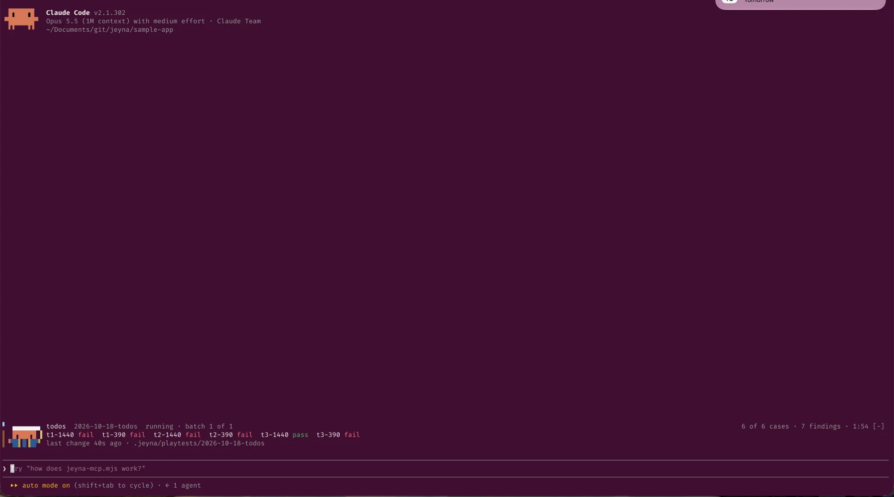
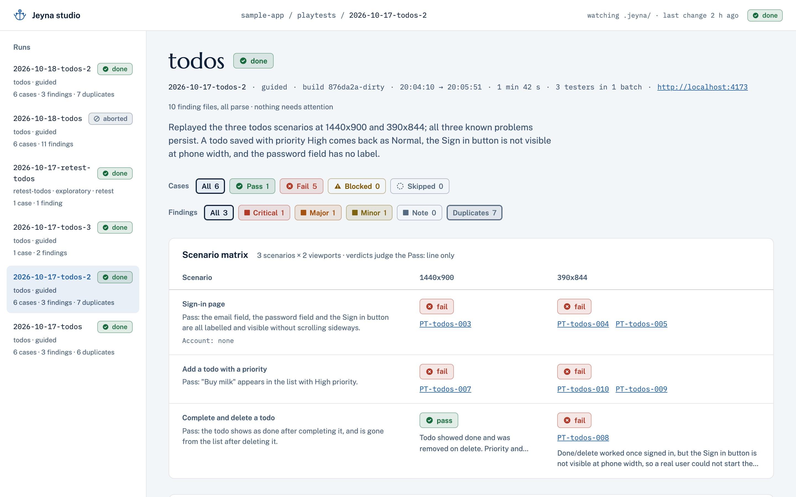

<p align="center">
  
</p>

<h1 align="center">Jeyna</h1>

<p align="center"><strong>Agentic playtesting for Claude Code</strong></p>

<p align="center">
  <a href="https://github.com/TheClaessens/jeyna/actions/workflows/check.yml"></a>
  <a href="https://github.com/TheClaessens/jeyna/tags"></a>
  
  
</p>

<p align="center">
  <a href="#abilities">Abilities</a> ·
  <a href="#install">Install</a> ·
  <a href="#how-to-use-it">How to use it</a> ·
  <a href="#commands">Commands</a> ·
  <a href="#config">Config</a> ·
  <a href="#development">Development</a>
</p>

Jeyna is a Claude Code plugin that plays your web app like a first-time user would, and writes down what it finds.

You type one command. Jeyna spins up a tester per scenario, each tester clicks through your app in a headless browser, and every problem it runs into ends up as a markdown file with a screenshot in `.jeyna/`. You read the report, or you hand the folder back to Claude and let it fix things.

## Abilities

Jeyna's features are called abilities. There are two so far.

**Playtest.** Claude plays your app for you.

- You run `/jeyna:playtest` with a flow you saved, or you just describe what you want tested and Jeyna proposes the scenarios. It asks before it runs them.
- Every scenario gets its own tester, in its own headless browser, at every viewport you configured. Give Jeyna a way to create test accounts and the testers all run at once.
- Every report tells you which verdicts changed since the last run of that flow. Fixed something? Retest that one finding by its id.

**Feedback.** You show Claude what should change.

- You snap or record a part of your running app, or of a finding's screenshot, and type what should change right next to it.
- `/jeyna:feedback` hands it to Claude, with exactly the pixels you selected.

A few things hold for both:

- Findings and feedback are markdown files in `.jeyna/`. You can read them, the studio reads them, and Claude reads them in your next session.
- The config only knows the names of your env variables. Their values never show up in a prompt or a finding.
- Nothing gets added to your project's dependencies. The plugin is the `plugin/` folder of this repo.

## What it looks like

<p align="center">
  
</p>

While a run is going, Jeyna's Watch sits above your prompt: which cases are done, how many findings so far, and where the run lives on disk.

<p align="center">
  
</p>

`/jeyna:studio` opens your runs in the browser: every finding with its screenshot, and what changed since the last run.

## Install

You need three things:

- Claude Code 2.1.302 or later
- Node 20 or later
- Google Chrome. No Chrome? `npx playwright install chromium` works too.

Chrome runs headless with a throwaway profile, so your own profile is never touched.

Then, inside Claude Code:

```
/plugin marketplace add TheClaessens/jeyna
/plugin install jeyna@jeyna
```

Nothing is published to npm and nothing is added to your project's dependencies.

## How to use it

1. **Run `/jeyna:init` once.** It looks at how your app starts and asks a few questions: the URL, which env variables hold your test accounts (the names, never the values), and whether screenshots get committed. It writes `.jeyna/jeyna.config.yaml` and `.jeyna/CONVENTIONS.md`.

2. **Put the account values in `.jeyna/.env`.** That file is gitignored. Exporting them before you start `claude` works too. Agents can't read or write the file, and the values never show up in a prompt or a finding.

3. **Run `/jeyna:playtest checkout`.** Give it a flow name, or just describe what you want tested. Without a flow, Jeyna takes a quick look at the app, proposes a few scenarios and asks before it runs them. When it's done, it offers to save them as a flow so you can run them again.

   Something like this comes back in your terminal:

   ```
   3 testers, 1 batch (2 accounts): Sign-in page, Add a product to the cart, Remove a product from the cart.

   Sign-in page: t1-1440x900 fail, t1-390x844 fail; 3 findings.
   Add a product to the cart: t2-1440x900 fail, t2-390x844 fail; 4 findings.
   Remove a product from the cart: t3-1440x900 pass, t3-390x844 fail; 3 findings.

   Replayed the three checkout scenarios at 1440x900 and 390x844; all three known problems
   persist. A product added with quantity 2 shows up with quantity 1, the Sign in button is
   not visible at phone width, and the password field has no label.

   Cases: 1 passed, 5 failed, 0 blocked, 0 skipped.
   Findings: 1 critical, 1 major, 1 minor, 0 notes; 7 marked duplicate.
     PT-checkout-004  critical  bug   Sign in button not visible at phone width
     PT-checkout-006  major     bug   Quantity 2 is saved as 1
     PT-checkout-001  minor     a11y  Password field on sign-in has no label
   Since 2026-10-17-checkout: Remove a product from the cart at 390x844: pass -> fail.
   Report: .jeyna/playtests/2026-10-17-checkout-2/report.md
   1 min 42 s, 3 testers.
   ```

4. **Open `/jeyna:studio`** to browse the run. Fixed something? `/jeyna:playtest PT-checkout-004` retests that one finding and marks it fixed if it passes.

## Commands

| Command                     | What it does                                                      |
| --------------------------- | ----------------------------------------------------------------- |
| `/jeyna:init`               | Sets up `.jeyna/` in your project. You run it once.               |
| `/jeyna:playtest [request]` | Runs a flow by name, or whatever you describe.                    |
| `/jeyna:playtest PT-…`      | Retests that one finding and marks it fixed if it passes.         |
| `/jeyna:studio [port]`      | Opens the studio on localhost. Port 4710 unless you give another. |
| `/jeyna:feedback [FB-…]`    | Lists your open feedback, or loads the one you name.              |
| `/jeyna:feedback-next`      | Loads the oldest open feedback item.                              |

## Flows

A flow is a markdown file in `.jeyna/flows/` with a few scenarios. Each scenario has a description and a `Pass:` line. That line is the only thing a tester judges the case against. Anything else it notices becomes a finding, but doesn't fail the case.

You don't have to write a flow by hand. Let a playtest propose the scenarios, save them, and edit the file afterwards.

```markdown
---
name: checkout
entry: /login
---

## Preconditions

The app runs on its configured url. Each account starts with an empty cart.

## Scenarios

### Sign-in page

Open the sign-in page without signing in and check that every control is labelled and on screen.
Pass: the email field, the password field and the Sign in button are all labelled and visible without scrolling sideways.
Account: none

### Add a product to the cart

Sign in, then add a product to the cart with quantity 2.
Pass: the cart shows the product with quantity 2.

### Remove a product from the cart

Sign in, add a product to the cart, then remove it.
Pass: the product shows in the cart after adding it, and the cart is empty after removing it.

## What matters most here

The cart keeps exactly what was added. Nothing about the sign-in form may be hidden at phone width.
```

The `Account:` line is optional:

- No line: the scenario signs in with the account its tester got.
- `Account: none`: don't sign in.
- `Account: consumes`: the scenario may lock or change its account (wrong passwords, a password reset), so it runs last.

## Findings

Every finding is one file under `.jeyna/playtests/<run>/findings/`. Its screenshot sits under `evidence/` in the same run folder.

```markdown
---
schema: 1
id: PT-checkout-001
kind: a11y
severity: minor
status: open
flow: checkout
case: t2-1440x900
scenario: Add a product to the cart
route: /login
viewport: 1440x900
browser: chromium 155.0.8059.80
build: 876da2a-dirty
author: sonnet
created: 2026-10-17T18:04:42.836Z
evidence:
  - t2-1440x900-1-login.png
---

# Password field on sign-in has no label

## Steps

1. Open /login
2. Read the form

## Expected

Password input has a visible label and accessible name

## Actual

Only Email is labelled; the second textbox has no label or name

## Evidence


```

A finding has a kind (`bug`, `ux`, `a11y` or `question`), a severity (`critical`, `major`, `minor` or `note`) and a status (`open`, `duplicate`, `wontfix` or `fixed`).

Findings are written by the server, never by an agent, so they always have the same shape. The whole `.jeyna/` folder is meant to be committed.

## Feedback

Feedback works the other way around: you see something, and you show Claude.

- **Live** opens your app in its own Chrome window. It has its own profile, so your logins stick.
- <kbd>⌥</kbd><kbd>⇧</kbd><kbd>S</kbd> freezes the page. Drag over what's wrong, type what should change, and save with <kbd>⌘</kbd><kbd>↩</kbd>. That's a snap.
- <kbd>⌥</kbd><kbd>⇧</kbd><kbd>R</kbd> records an area while you use the app instead.
- On a finding, **Give feedback** does the same over its screenshot.

Each item lands in `.jeyna/feedback/` with exactly the pixels you selected. `/jeyna:feedback` lists what's open and lets you pick one, a few, or all of them one by one. Claude marks an item processed once it has made the change, and only you mark it done.

## Config

`/jeyna:init` writes `.jeyna/jeyna.config.yaml`. Edit it as you like.

| Key                             | What it does                                                                                                                                                                                                   | Default               |
| ------------------------------- | -------------------------------------------------------------------------------------------------------------------------------------------------------------------------------------------------------------- | --------------------- |
| `app.name`                      | The name of your app                                                                                                                                                                                           | asked at init         |
| `app.url`                       | Base URL of the app under test                                                                                                                                                                                 | asked at init         |
| `app.build`                     | A fixed build id for the reports. Leave it `null` and Jeyna uses `git describe --always --dirty`                                                                                                               | `null`                |
| `app.reset`                     | Shell command that runs before every run, so every run starts from the same state. If it fails, the run doesn't start                                                                                          | `null`                |
| `app.new_account`               | Shell command that creates a new test user on every call and prints `JEYNA_USER=<username>` and `JEYNA_PASS=<password>`. With it, every tester that signs in gets its own account, so they can all run at once | `null`                |
| `viewports`                     | Every scenario runs once per viewport                                                                                                                                                                          | `[1440x900, 390x844]` |
| `browser.headed`                | Shows the browser, handy while you tune a run                                                                                                                                                                  | `false`               |
| `tester.model`, `tester.effort` | Model and effort for the testers                                                                                                                                                                               | `sonnet`, `medium`    |
| `tester.parallel`               | The most testers that run at once                                                                                                                                                                              | `20`                  |
| `accounts`                      | `{ handle, user_env, pass_env }` per test account. Env variable names, never values. No two testers share an account, so with a small pool the testers run in batches                                          | `[]`                  |

`.jeyna/CONVENTIONS.md` tells the testers what counts as a bug, a ux issue or an a11y issue, and how to grade severity. It goes into every tester prompt, so make it fit your app.

## Development

```sh
npm install
npm run build         # bundles plugin/server and plugin/studio
npm test
npm run check         # test + typecheck + bundle check; run it before every commit
```

The bundles under `plugin/server/` and `plugin/studio/` are committed, so rebuild and commit them with any source change. `npm run check` fails if they're stale.

Where things live:

- `src/`: the MCP server and the studio, tests next to the code.
- `plugin/`: what gets installed. Skills, the tester agent, hooks, templates and the committed bundles.
- `docs/`: concept, architecture and decisions.

Want to know why something works the way it does? Start with the [glossary](GLOSSARY.md), then the [concept](docs/jeyna-concept.md), the [architecture](docs/jeyna-architecture.md) and the [decisions](docs/decisions.md). The [coding standards](CODING_STANDARDS.md) are there for when you change code.

Found a bug, or missing something? Open an [issue](https://github.com/TheClaessens/jeyna/issues).

## License

I haven't picked one yet.
