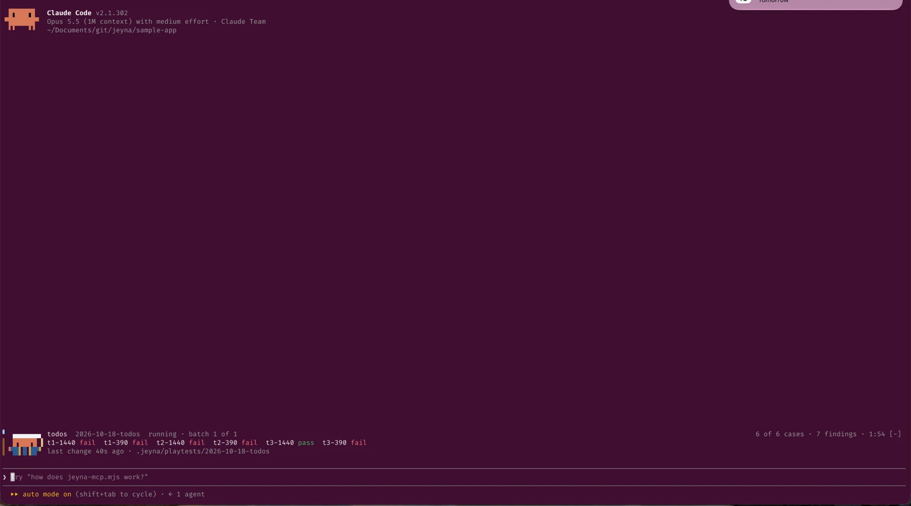
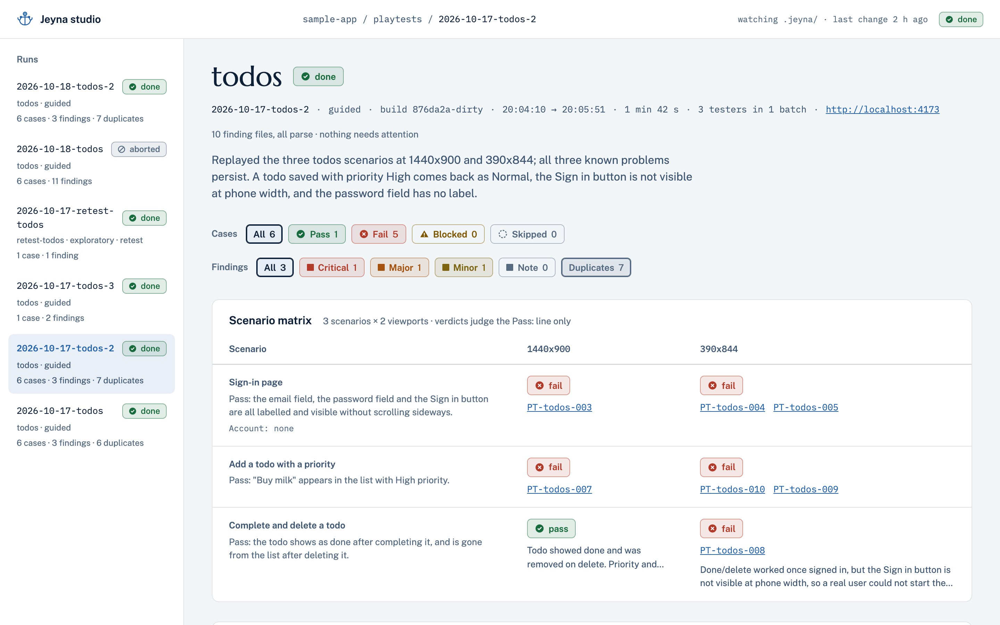

<p align="center">
  
</p>

<h1 align="center">Jeyna</h1>

<p align="center">Agentic playtesting for Claude Code</p>

<p align="center">
  
  
  
  
</p>

Jeyna is a Claude Code plugin that plays your web app the way a careful first-time user would and writes down what it finds. You type one slash command in your own Claude Code session; Jeyna spawns one tester subagent per scenario, each driving a headless browser through a local MCP server, and every finding lands on disk as a markdown file with a screenshot the moment it is recorded. The `.jeyna/` folder is the product: git-tracked, readable by people, by the bundled studio, and by Claude in your next session.

How a run goes:

1. You type `/jeyna:playtest todos` (a flow name, a free-text request, or a finding id to retest).
2. Testers play the app in headless Chrome, one browser context per scenario and viewport, with their own test account.
3. Findings land as `findings/PT-todos-001.md` with frontmatter, Steps / Expected / Actual and a PNG under `evidence/`.
4. `report.md` closes the run: counts, scenario matrix, what changed since the last run of that flow, findings by severity.
5. You read it in the terminal, in the studio (`/jeyna:studio`), or hand the folder back to Claude to fix what it found.

## Screenshots

<p align="center">
  
</p>

Jeyna's Watch during a run of the sample app: six cases, their verdicts as they land, seven findings so far, the run path.

<p align="center">
  
</p>

The same run in Jeyna studio: the runs rail, count chips that filter, the scenario x viewport matrix with each case's verdict and findings.

## Installation

The GitHub repository is the plugin marketplace. Nothing is published to npm and nothing enters your project's dependencies (D13). Inside Claude Code:

```
/plugin marketplace add TheClaessens/jeyna
/plugin install jeyna@jeyna
```

The second command opens the plugin's details in the `/plugin` panel, where you install it. The same works from a shell with `claude plugin marketplace add TheClaessens/jeyna` and `claude plugin install jeyna@jeyna`. The install id is `<plugin>@<marketplace>`; both are named `jeyna` in [`.claude-plugin/marketplace.json`](.claude-plugin/marketplace.json).

**Requirements**

- Claude Code 2.1.302 or later (the version the loop, the studio and the band were verified on; the band uses function-hooks modules, which need it).
- Node 20 or later on your PATH (`node` starts the MCP server and the studio).
- Google Chrome installed. The server launches it headless with a temporary profile and never touches your own profile. If Chrome is missing, Playwright's Chromium works after `npx playwright install chromium`; `get_context` tells you in one line when that is needed.

**What gets installed**

Only the `plugin/` folder, copied into Claude Code's plugin cache:

- `server/jeyna-mcp.mjs`: the MCP server, one esbuild bundle with its dependencies committed per release. `.mcp.json` starts it as `node ${CLAUDE_PLUGIN_ROOT}/server/jeyna-mcp.mjs --project ${CLAUDE_PROJECT_DIR}`.
- `studio/`: the studio sidecar and UI, bundled the same way.
- `skills/` (`init`, `playtest`, `studio`), `agents/jeyna-tester.md`, `hooks/` (the write guard, the exit check and the Watch module), `templates/` for `/jeyna:init`.

No skill, agent or hook is ever copied into your project; the plugin namespace is the distribution.

## Quick start

**1. Set up the project once: `/jeyna:init`.** It looks at how your app starts, then asks one round of questions:

- the app URL (it proposes one from `package.json` or the framework config);
- test accounts: a handle per account and the *names* of the two environment variables holding its username and password (`JEYNA_USER_A_USER`, `JEYNA_USER_A_PASS`). It never asks for a value;
- whether screenshots under `.jeyna/playtests/*/evidence/` are committed or gitignored.

It writes `.jeyna/jeyna.config.yaml`, `.jeyna/CONVENTIONS.md`, an empty `.jeyna/.env`, the `.gitignore` lines, and validates the result with `get_context`.

**2. Fill `.jeyna/.env`** with the account values, or export the variables in the shell before starting `claude`. Agents cannot write this file and never see its values.

**3. Write a flow, or let the loop write one.** A flow is `.jeyna/flows/<name>.md`: scenarios with a `Pass:` line each (format below). Without a flow, `/jeyna:playtest <request>` takes a short scout look at the app, proposes two to five scenarios, waits for your yes, and offers to save them as a flow when the run is done.

**4. Run it: `/jeyna:playtest todos`.** The main agent reports one line per tester as it returns, then the report:

```
3 testers, 1 batch (2 accounts): Sign-in page, Add a todo with a priority, Complete and delete a todo.

Sign-in page: t1-1440x900 fail, t1-390x844 fail; 3 findings.
Add a todo with a priority: t2-1440x900 fail, t2-390x844 fail; 4 findings.
Complete and delete a todo: t3-1440x900 pass, t3-390x844 fail; 3 findings.

Replayed the three todos scenarios at 1440x900 and 390x844; all three known problems
persist. A todo saved with priority High comes back as Normal, the Sign in button is
not visible at phone width, and the password field has no label.

Cases: 1 passed, 5 failed, 0 blocked, 0 skipped.
Findings: 1 critical, 1 major, 1 minor, 0 notes; 7 marked duplicate.
  PT-todos-004  critical  bug   Sign in button not visible at phone width
  PT-todos-006  major     bug   Chosen priority High is saved as Normal
  PT-todos-001  minor     a11y  Password field on sign-in has no label
Since 2026-10-17-todos: Complete and delete a todo at 390x844: pass -> fail.
Report: .jeyna/playtests/2026-10-17-todos-2/report.md
1 min 42 s, 3 testers.
```

**5. Read along: `/jeyna:studio`.** Opens the read-only viewer on `http://localhost:4710/`; a running playtest shows up as it writes.

## Concepts

One line each; the full definitions are in [`GLOSSARY.md`](GLOSSARY.md).

- **Run**: one execution of `/jeyna:playtest`, stored as one folder `.jeyna/playtests/<yyyy-mm-dd>-<slug>[-<n>]/`. Guided when its scenarios come from a flow, exploratory when they were derived from the prompt.
- **Flow**: a named set of scenarios for one area of the app, in `flows/<name>.md`. Usually first written by the loop, then edited by people.
- **Scenario**: one named path through a flow: a description, a `Pass:` line, an optional `Account:` line (`none` or `consumes`).
- **Pass line**: the one sentence a tester judges the case against. Nothing else fails a case.
- **Tester**: one `jeyna-tester` subagent per scenario; runs that scenario's cases in sequence. Sonnet at medium effort by default.
- **Case**: one (scenario, viewport) pair, with its own browser context, evidence prefix and verdict. Browser tools are keyed by case.
- **Finding**: one observed divergence, one file `findings/PT-<slug>-<nnn>.md`. Kind `bug`, `ux`, `a11y` or `question`; severity `critical`, `major`, `minor` or `note`; status `open`, `duplicate` (with `of`), `wontfix` or `fixed`.
- **Verdict**: `pass`, `fail`, `blocked` or `skipped` for one case, recorded by the tester and checked by the server. A `fail` needs at least one finding.
- **Evidence**: PNG files under the run's `evidence/`, named `<case>-<seq>[-<label>].png`, referenced by name from findings. No clips in v0.
- **Report**: `report.md`, written by `session_finish`: counts, scenario matrix, since last run, findings sorted by severity then kind.
- **Since last run**: the verdicts that changed against the latest done run of the same flow. Verdicts, not findings: finding ids restart per run.
- **Retest**: `/jeyna:playtest PT-<slug>-<nnn>` plays that one finding at its viewport, judged against its Expected. A `pass` marks the finding `fixed`.

## The file contract

Everything a run produces is a file, written only by the server, never by an agent.

```
.jeyna/
  jeyna.config.yaml          app url, viewports, tester model, accounts as env variable names
  CONVENTIONS.md             what counts as a finding per kind; read by every tester
  .env                       account values; gitignored, written by people only
  index.json                 the studio's derived cache; gitignored
  flows/
    todos.md                 scenarios with Pass: lines; optional
  playtests/
    2026-10-17-todos-2/
      session.json           status, scope, build, testers, cases, verdicts (status, not record)
      report.md              the run's summary, matrix, since last run, findings table
      server.log             one line per tool call while the run ran; no page text (runs since D33)
      hooks.log              what the write guard and exit check saw
      findings/
        PT-todos-001.md      one finding
        ...
      evidence/
        t2-1440x900-1-login.png
        ...
```

A finding file in full, [`PT-todos-001.md`](sample-app/.jeyna/playtests/2026-10-17-todos-2/findings/PT-todos-001.md) from the run above:

```markdown
---
schema: 1
id: PT-todos-001
kind: a11y
severity: minor
status: open
flow: todos
case: t2-1440x900
scenario: Add a todo with a priority
route: /login
viewport: 1440x900
browser: chromium 155.0.8059.80
build: 876da2a-dirty
author: sonnet
created: 2026-10-17T18:04:42.836Z
evidence:
  - t2-1440x900-1-login.png
---

# Password field on sign-in has no label

## Steps

1. Open /login
2. Read the form

## Expected

Password input has a visible label and accessible name

## Actual

Only Email is labelled; the second textbox has no label or name

## Evidence


## Suggested next step

None given.
```

A flow file is YAML frontmatter (`name`, `entry`, optional `viewports` and `accounts`), optional `## Preconditions` and `## What matters most here` sections that go into every tester prompt, and under `## Scenarios` one `### <name>` heading per scenario with a description, a `Pass:` line and an optional `Account:` line. The sample app's flow, [`sample-app/flows/todos.md`](sample-app/flows/todos.md):

```markdown
---
name: todos
entry: /login
---

## Preconditions

The app runs on its configured url. Each account starts with an empty todo list.

## Scenarios

### Sign-in page
Open the sign-in page without signing in and check that every control is labelled and on screen.
Pass: the email field, the password field and the Sign in button are all labelled and visible without scrolling sideways.
Account: none

### Add a todo with a priority
Sign in, then add a todo called "Buy milk" with priority High.
Pass: "Buy milk" appears in the list with High priority.

### Complete and delete a todo
Sign in, add a todo, mark it complete, then delete it.
Pass: the todo shows as done after completing it, and is gone from the list after deleting it.

## What matters most here

Todos keep exactly what was typed and chosen. Nothing about the sign-in form may be hidden at phone width.
```

`Account: none` means the scenario must not sign in; `Account: consumes` means it may lock or change its account (wrong passwords, a password reset), so it runs last, at most one per account. Without the line, the scenario signs in with the account its tester holds.

## Configuration

`.jeyna/jeyna.config.yaml` is written by `/jeyna:init` from [`plugin/templates/jeyna.config.yaml`](plugin/templates/jeyna.config.yaml) and hand-edited afterwards; `get_context` validates it at the start of every run.

| Key | Meaning | Default |
|---|---|---|
| `app.name` | Name shown in reports and the studio | asked at init |
| `app.url` | Base URL of the app under test; `goto` paths are relative to it | asked at init |
| `app.build` | Fixed build id for reports; `null` uses `git describe --always --dirty` in the project root | `null` |
| `app.reset` | Shell command run from the project root before every run so each run starts from the same state (`npm run db:seed`, `curl -fsS -X POST http://localhost:4173/__reset`). A non-zero exit refuses the run | `null` |
| `viewports` | `WxH` strings. Each is one case per scenario, run in sequence by the scenario's tester | `[1440x900, 390x844]` |
| `browser.headed` | `true` shows the browser while you tune a run | `false` |
| `tester.model`, `tester.effort` | Model and effort passed on every tester spawn | `sonnet`, `medium` |
| `accounts` | The test-account pool: `{ handle, user_env, pass_env }` per account. Env variable names only, never values | `[]` |

`.jeyna/CONVENTIONS.md` ([template](plugin/templates/CONVENTIONS.md)) tells testers what counts as a finding for each kind, how severity is graded, and anything project-specific under "Project notes". It goes verbatim into every tester prompt; edit it to fit your app.

**Secrets.** Account values live in the shell environment or in the gitignored `.jeyna/.env`; a variable exported before `claude` starts wins over the file. A tester signs in by filling `{{account.user}}` and `{{account.pass}}`; the server substitutes the real values at `fill` time and redacts them back to the placeholders in every text result, before any truncation. The write guard denies `Write` and `Edit` on `.jeyna/.env`, so no agent can change it, and no value ever reaches a prompt, a transcript or a run file.

## Jeyna studio

`/jeyna:studio [port]` starts the studio (default port 4710) and gives you the URL. It is a Node sidecar that watches `.jeyna/` recursively, validates every file with the same rules the server uses, renders finding bodies, and pushes one index over SSE after every change; the page follows a running playtest live, including "Since last run". It needs no install, never edits a playtest file, writes only feedback items under `.jeyna/feedback/`, and keeps its derived `.jeyna/index.json` gitignored.

What it shows: the runs rail with status chips; per run, count chips that double as filters, the scenario x viewport matrix with verdicts and linked findings, Since last run, and the findings table with duplicates folded under the finding they duplicate (toggle "Show duplicates"). Per finding, Steps / Expected / Actual / Suggested next step, evidence at natural size, and the source file. Filters live in the URL (`?verdict=fail&severity=critical,major&kind=bug`), so a view is a link; `j` and `k` step through findings in the current filter.

**Needs attention.** A finding or `session.json` that does not parse, or a check that fails, is listed in its own lane with its errors and its source. It never counts and is never dropped.

**Feedback.** Show Claude what should change, on the pixels you see (D36, D37). **Live** opens your app in its own Chrome window, with this project's profile in the gitignored `.jeyna/chrome-profile/` so logins are kept. In that window, ⌥⇧S (Alt+Shift+S) freezes the page: drag over what matters, at full size, write what should change, ⌘↩. ⌥⇧R records an area while you use the app, a frame every half second for up to 20 s, then plays it back in place before you save. On a finding, **Give feedback** does the same over its evidence. Each item lands in `.jeyna/feedback/FB-<nnn>.md` with exactly the selected pixels, and Claude picks it up with `/jeyna:feedback` (what is to do, or one `FB-<nnn>`) or `/jeyna:feedback-next`. Claude marks an item `processed` when it has made the change, and `done` only on your OK.

## Jeyna's Watch

While a run is live, a three-line band sits above the prompt: Jeyna the Crab, then the flow, run id, status and batch with the case tally and elapsed time; every case id with its verdict word; and the last-change age with the run path (the report path once the run is done).

```
▘ ▗▄▄▄▄▄▄▖  todos  2026-10-18-todos  running · batch 1 of 1        6 of 6 cases · 7 findings · 1:54
▌ ▐▛███▜▌▐  t1-1440 fail  t1-390 fail  t2-1440 fail  t2-390 fail  t3-1440 pass  t3-390 fail
▌▝▜█▌█▐█▛▘  last change 40s ago · .jeyna/playtests/2026-10-18-todos
```

The crab is quarter-block characters, one colour per cell (hair, face, coat on their own lines; staff with a frost tip). The band reads `session.json` once a second and nothing else: it never talks to the testers or the server. It appears when a run starts, lingers about a minute after the run ends or aborts so the report path stays readable, then disappears. Case ids drop the viewport height (`t1-1440x900` reads `t1-1440`). Start `claude` in the folder that holds `.jeyna/`. It is the plugin's first mod: a function-hooks module at [`plugin/hooks/watch/register.tsx`](plugin/hooks/watch/register.tsx) (D35).

## The sample app

[`sample-app/server.mjs`](sample-app/server.mjs) is a zero-dependency todo list behind a login with password reset, in-memory state, two accounts, and six seeded bugs for scoring a run against an answer key ([`sample-app/SEEDED-BUGS.md`](sample-app/SEEDED-BUGS.md)). Testers cannot read that file.

| # | Bug | Kind | Where |
|---|---|---|---|
| 1 | After a password reset, the old password still works | bug | `/reset` adds the new password instead of replacing it |
| 2 | The Sign in button is pushed off screen at 390 px wide | ux | `/login`, the `.actions` row is 560 px wide |
| 3 | The password field has no label | a11y | `/login`, the password `<input>` |
| 4 | Saving a todo drops the chosen priority; every todo is saved as Normal | bug | `POST /todos` ignores `priority` |
| 5 | The lockout after 3 wrong passwords never ends, even after a reset | bug | `POST /login` never clears the failure count |
| 6 | A wrong password echoes the typed username back into the page | bug | `POST /login` error message (tests redaction: the tester sees `{{account.user}}`) |

To run a playtest against it from this checkout:

```sh
node sample-app/server.mjs                     # http://localhost:4173, POST /__reset reseeds everything
cd sample-app
cp .env.example .jeyna/.env                    # the two test accounts; values are in .env.example
claude --plugin-dir ../plugin                  # or the installed plugin
```

Then `/jeyna:playtest todos`. `sample-app/.jeyna/` is already set up with the config (including `app.reset`), the conventions, the `todos` flow and several real runs; `/jeyna:studio` shows them.

## Development

```sh
npm install           # build-time only; the committed lockfile is package-lock.json
npm run build         # esbuild: plugin/server/jeyna-mcp.mjs and plugin/studio/*
npm test              # build, then vitest over MCP stdio against the bundle
npm run typecheck
npm run check         # test + typecheck + scripts/check.mjs; the gate before every commit
npm run studio        # the studio against sample-app/
```

`npm run check` fails when the committed bundles differ from a fresh build, so rebuild and commit `plugin/server/` and `plugin/studio/` with any source change. esbuild writes each bundled module's path into the bundle; `build.mjs` folds pnpm's `node_modules/.pnpm/<name>@<version>/node_modules/` to npm's `node_modules/`, so an npm and a pnpm install build the same bytes (D35).

Repo layout:

- `src/`: the server (schema, session, browser, findings, finish, validate), `src/studio/` (sidecar, UI), tests beside the code.
- `plugin/`: what gets installed. Committed bundles under `server/` and `studio/`; skills, agents, hooks, templates, the Watch module and its `claude plugin test` suite under `tests/`.
- `docs/`: concept, architecture, functional analysis, [`decisions.md`](docs/decisions.md) (D-numbered decisions), `agents/` (platform notes and implementer rules), `design/` (the anchor and the crab).
- `sample-app/`: the app with the seeded bugs, its flow, and real runs under `.jeyna/`.

The glossary is [`GLOSSARY.md`](GLOSSARY.md) at the root; decisions are D-numbered entries in [`docs/decisions.md`](docs/decisions.md); judgement calls for review are in [`CODING_STANDARDS.md`](CODING_STANDARDS.md). The design canvas the studio and the mascot were drawn on is private.

## Guardrails and non-goals

- **No secrets in prompts.** Config holds env variable names; values are substituted server-side and redacted on the way out; `/jeyna:init` asks for names only.
- **Agents never write run files.** Findings enter through `record_finding` with a schema and are rendered to markdown by the server; a PreToolUse hook denies `Write`/`Edit` under `.jeyna/playtests/` and on `.jeyna/.env`; `session_finish` refuses an invalid run.
- **Verdicts judge the `Pass:` line only.** A tester records what else it sees as findings and does not fail a case for it.
- **A run judges the app through the browser.** The main agent never reads the app's source, build or git history to decide what to run or what a verdict should be.
- **No performance findings in v0.** Nothing in a run measures time.
- **Personas are v1.** Every tester is a careful first-time user; identity axes get their own tester later under a new schema version.
- **No reviewer agent in v0.** The main agent marks duplicates.
- **Cost.** A run is minutes and a few dollars (the run above: 1 min 42 s, 3 Sonnet testers). It runs on demand, not per commit.

## Status

v0.1.0, release candidate on `v0-integration`.

Verified live on the sample app with Claude Code 2.1.302: guided and exploratory runs, `save_flow`, `app.reset` before each run, "Since last run", the retest of one finding, the studio following a run, and the Watch band appearing, filling and disappearing. The server, converter, validator, studio model and band renderer are covered by vitest against the committed bundles (`npm run check`).

Pending: console lines quoted in findings (the todos flow raises no failing request, so no tester has had one to quote); the `authentication` flow's back-to-back runs; how terminal palettes draw the band's colours; severity drift between testers. Details and the open questions are in [`docs/decisions.md`](docs/decisions.md) (D31 to D35).

## License

License: not yet chosen.
