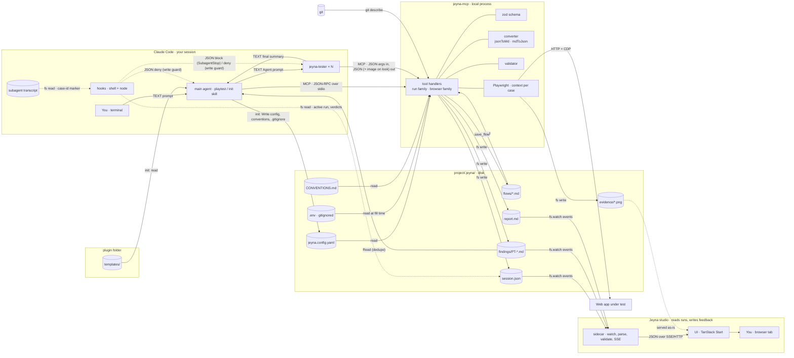

# Jeyna — architecture of the playtest loop

Who talks to whom, over what, in which format. Four runtime lanes and one folder. Everything crossing a lane boundary is an MCP call (JSON), an agent prompt or return (TEXT), a hook payload (JSON), a file on disk (markdown, YAML, JSON, `.env` or PNG), or a shell exec. There is no channel between Claude Code and the studio; the folder is the only thing they share.

Decision references (Dn) point to `docs/decisions.md`; terms are defined in `GLOSSARY.md`.

## Components by lane

**Claude Code (the developer's session, one process)**
- You, in the terminal: `/jeyna:init` once per project, then `/jeyna:playtest authentication`.
- Main agent running the `playtest` skill: resolves scope (scout look in exploratory mode), starts the session, spawns testers batch by batch, waits, reads findings with `Read`, marks duplicates, calls `session_finish`. No reviewer agent in v0 (D12). Running the `init` skill, it writes `.jeyna/` from the plugin's templates (D13). Running the `feedback` or `feedback-next` skill, it loads one feedback item at a time with `get_feedback`, follows the developer's lead, and sets `processed` after implementing and `done` only on the developer's OK (D36).
- `jeyna-tester` × N (model `sonnet`, effort `medium` by default; config override passed per spawn, D15): one subagent per scenario, each with its own context window; runs one case per viewport in sequence, each in a fresh browser context. Tools allowlist: eight exact jeyna-mcp names (browser family, `record_finding`, `scenario_verdict`). No Read/Write/Edit/Bash, no other browser, no run-control tools. Returns a short TEXT summary to the main agent.
- Hooks (shell + node): PreToolUse denies Write/Edit/NotebookEdit under `.jeyna/playtests/` and `.jeyna/feedback/` and on `.jeyna/.env`; SubagentStop blocks a tester once if any of its cases has no verdict. They read `session.json` and the tester's transcript; they do not run `jeyna validate` (D2).

**jeyna-mcp (local child process, stdio)**
Started by the plugin as `node ${CLAUDE_PLUGIN_ROOT}/server/jeyna-mcp.mjs --project ${CLAUDE_PROJECT_DIR}`: a committed bundle, no npm on the user's machine (D13). Server key `mcp`, tools exposed as `mcp__plugin_jeyna_mcp__<tool>` (D1).
- Tool handlers, run family: `get_context`, `get_flow`, `session_start`, `scenario_verdict`, `record_finding`, `update_status` (findings and feedback items), `validate`, `session_finish`, `save_flow`; `get_feedback` (D36).
- Tool handlers, browser family (every call carries `case`; `scout` is a reserved session-less case for the exploratory look and writes nothing, D6): `goto`, `click`, `fill`, `press`, `snapshot`, `screenshot`. Every text result passes one redaction step that replaces account values with placeholders (D9).
- zod schema: finding, session, report, config, flow.
- Session state: held in memory during a run; `session.json` is a copy written through one queue (temp + rename), never read back mid-run (D11).
- Converter: JSON → markdown (template), markdown → JSON (gray-matter + headings).
- Validator: a function called by `validate` and by `session_finish`, which refuses while errors remain (D2). The same bundle also runs it from a shell as `node jeyna-mcp.mjs validate <runDir>`.
- Playwright: one headless browser (installed Chrome via `channel: "chrome"`, temporary profile; fallback Playwright's Chromium), one BrowserContext per case, own cookies; the tester's account, never shared by two running testers (D10, D13).
- Secrets: account values are read at `fill` time from the server's environment, else from `.jeyna/.env`; never returned, never written (D18).
- Build id: `git describe --always --dirty` in the project root (D7).

**project/.jeyna/ (files on disk, git-tracked except where noted)**
- `jeyna.config.yaml` — YAML — app url, viewports, tester model, account pool as env variable names.
- `.env` — dotenv — account values; gitignored, written by you, never by Claude (D18).
- `CONVENTIONS.md` — MD — what counts as a finding per kind; returned by `get_context`, put into every tester prompt.
- `flows/*.md` — MD+YAML — optional; scenarios, `Pass:` and `Account:` lines.
- `playtests/<run>/session.json` — JSON — status, scope, build, testers, cases, verdicts. Status, not record.
- `playtests/<run>/findings/PT-*.md` — MD+YAML — one file per finding. The record.
- `playtests/<run>/report.md` — MD+YAML — summary and scenario matrix.
- `playtests/<run>/evidence/*` — PNG — screenshots; committed or gitignored per project, chosen at init.
- Committed with the branch; context for every later session.

**Jeyna studio (ships inside the plugin as committed bundles, started by `/jeyna:studio`, D34; writes only feedback items, D36)**
- Sidecar (Node, `plugin/studio/jeyna-studio.mjs`): `fs.watch` on `.jeyna/` (recursive, its own `index.json` ignored); reads every run with the server's own `src/validate.ts` (same zod schema, same checks) and renders finding bodies with remark; what does not parse goes to the "needs attention" lane with its source, never dropped; keeps a derived `.jeyna/index.json` (gitignored); serves `evidence/` and feedback captures as files; pushes the whole index over SSE after every change. Creates, edits and deletes `.jeyna/feedback/FB-*` through `src/feedback.ts`, only for requests whose Origin is the studio page (D36).
- UI (TanStack Router, client-rendered, `plugin/studio/app.js`): `/runs/<id>` with the runs rail, counts as filter chips, scenario × viewport matrix, Since last run, the findings table with duplicates folded; `/runs/<id>/findings/<id>` with Steps / Expected / Actual, evidence at natural size, source. Filters live in the URL. `/live` frames `app.url` and captures it with the Screen Capture API; `/feedback` and `/feedback/<id>` list and edit feedback items; a finding's evidence has Give feedback (D36).
- You, in a browser tab on localhost, reading along during the run.

**Web app under test**: any URL (dev server, staging, preview; in this repo the `sample-app/`, D16). Reached only from inside jeyna-mcp's Playwright contexts over HTTP + CDP. Nothing else touches a browser.

## Diagram

## Every boundary crossing

| From → to | Channel | Format | Schema owned by |
|---|---|---|---|
| You → main agent | Claude Code prompt (`/jeyna:playtest`, `/jeyna:init`, `/jeyna:feedback`, `/jeyna:feedback-next`) | TEXT | the skills |
| Plugin templates → main agent → `.jeyna/` | `init` skill reads templates, writes with `Write` | YAML config, MD conventions, `.env` with empty entries, `.gitignore` line | the plugin templates; validated by `get_context` |
| Main agent → testers | Agent tool, in-process | TEXT prompt: marker line `jeyna-tester-cases: …`, scenario, per-case viewport, account handle, conventions | the skill |
| Testers → main agent | Agent tool return | TEXT summary (cases, verdicts, finding ids) | the skill |
| Agents → jeyna-mcp | MCP tool calls, JSON-RPC over stdio | JSON args in; JSON result out, plus image content for `screenshot` only when `look: true` | jeyna-mcp (zod → JSON Schema in the tool definitions) |
| jeyna-mcp → web app | Playwright, one context per case | HTTP + CDP | n/a |
| jeyna-mcp → `.jeyna/` | fs write | JSON `session.json` · MD+YAML findings, report, saved flows · PNG evidence | jeyna-mcp (same zod schema, rendered by the converter) |
| `.jeyna/` → jeyna-mcp | fs read | YAML config · MD conventions · MD+YAML flows · dotenv `.env` (values only at `fill` time) | you, by hand (flows also promoted from exploratory runs) |
| git → jeyna-mcp | exec `git describe --always --dirty` | TEXT | git |
| `.jeyna/` → main agent | `Read` | MD+YAML findings (for dedupe) | jeyna-mcp |
| Claude Code → hooks | hook payload on stdin | JSON (`tool_input.file_path`; `agent_type`, `agent_transcript_path`, `stop_hook_active`) | Claude Code |
| Subagent transcript → hooks | fs read of `agent_transcript_path` | JSONL; the hook looks for the marker line | Claude Code (format), the skill (marker) |
| Hooks → `.jeyna/` | fs read | `session.json` (active run, verdicts) | jeyna-mcp |
| Hooks → Claude Code | stdout | JSON `{decision: "block", reason}` or `permissionDecision: "deny"`; reason is TEXT for the agent | Claude Code |
| `.jeyna/` → sidecar (v1) | fs.watch events, then fs read | MD+YAML → parsed to JSON (frontmatter, body sections as HTML) | `src/validate.ts`, shared with the server (D34) |
| Sidecar → UI (v1) | localhost HTTP + SSE | one JSON index for the whole folder; evidence as files | `src/studio/types.ts` |
| CI → validator (v1) | shell exec | TEXT exit code + stderr | jeyna-mcp; how CI obtains the bundle is a v1 question |
| Claude Code ↔ Jeyna studio | **none** | — | The folder is the only shared thing. Run progress in the studio is a side effect of files being written one at a time. |

## Formats

- **JSON, while moving.** Tool arguments and results, hook payloads and decisions, `session.json`, the derived `index.json`, what the sidecar pushes to the UI. Anything a program produces for another program. The finding schema is defined once in zod and exported as JSON Schema for the MCP tool definitions.
- **MD+YAML, while resting.** Findings, reports, flows. Frontmatter is the structured half (the same fields as the JSON) and is what the viewer filters and counts on. The body is prose for people and for Claude in later sessions. Run files are written only by the converter, never by an agent.
- **YAML, configuration.** Only `jeyna.config.yaml`. Written by `/jeyna:init`, then edited by you; read by jeyna-mcp. No secrets, only env variable names.
- **dotenv, secrets.** Only `.jeyna/.env`, gitignored, filled in by you. Read by jeyna-mcp at `fill` time; Claude cannot write it (write guard) and never sees its values (redaction).
- **PNG, evidence.** Screenshots go to `evidence/` straight from the Playwright context. Referenced by relative path from the markdown.
- **TEXT, between agents.** Prompts from the main agent to its testers, their return summaries, and the reason a hook gives when it blocks. All are read by a model, so they are sentences, not structures; the one exception is the tester marker line, which a hook parses.
- **One schema, three readers.** The zod schema is imported by the MCP tool definitions (validate on call), by the converter (render to file), and by the sidecar (validate on read). Change it in one place; a `schema` version field in every file lets old runs still render.
