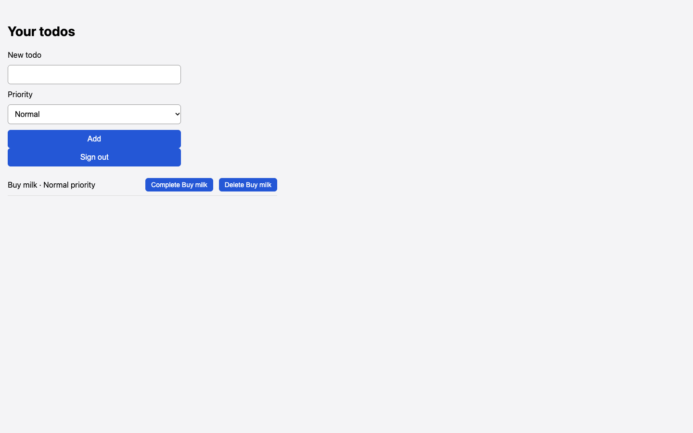

# Todo added with High priority is saved as Normal priority

## Steps

1. Sign in
2. Type Buy milk in New todo
3. Choose High in Priority
4. Click Add

## Expected

Buy milk · High priority

## Actual

List shows 'Buy milk · Normal priority'; chosen priority ignored.

## Evidence

## Suggested next step

None given.
