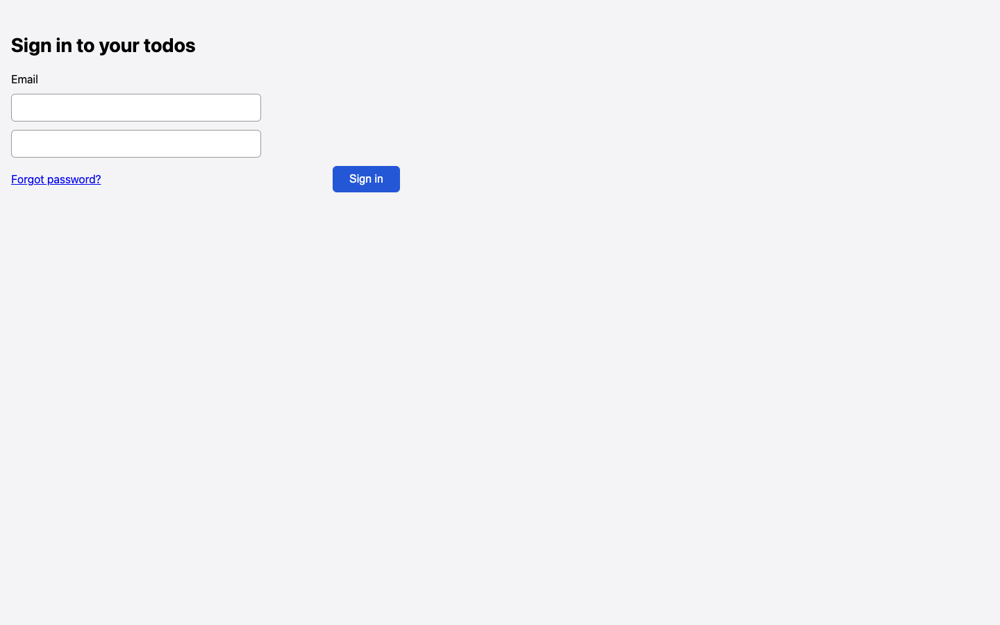

# Password field has no label or visible text

## Steps

1. Open /login
2. Read the form

## Expected

Password input has a visible label and accessible name

## Actual

Only Email is labelled; the second textbox has no label, name or placeholder

## Evidence

## Suggested next step

None given.
