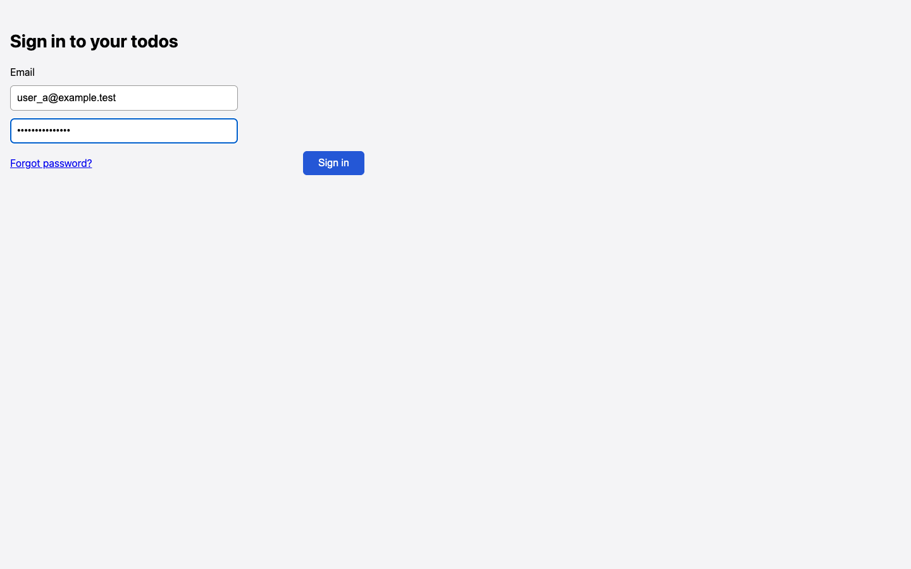

# Password field on sign-in has no label or accessible name

## Steps

1. Open /login
2. Read the snapshot

## Expected

Password input labelled

## Actual

Only Email has a label; the second textbox is unnamed (screenshot shows no Password label)

## Evidence

## Suggested next step

None given.
