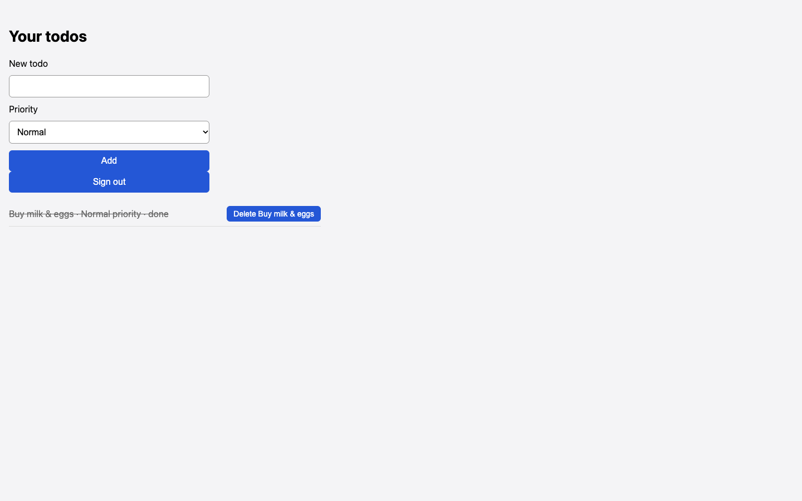

# Chosen High priority is saved as Normal

## Steps

1. Sign in
2. Type 'Buy milk & eggs'
3. Set Priority to High
4. Click Add

## Expected

Todo shows High priority

## Actual

Todo listed as 'Buy milk & eggs · Normal priority'

## Evidence

## Suggested next step

None given.
