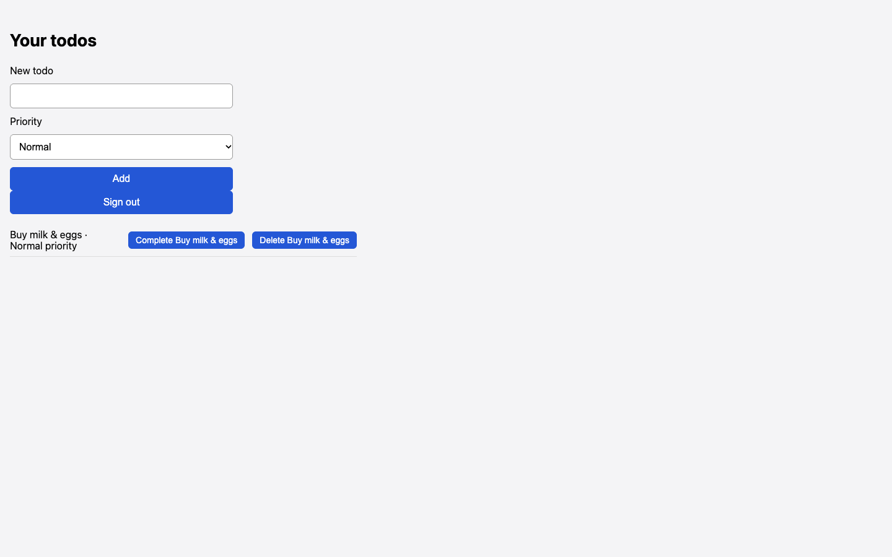

# Chosen priority High is saved as Normal

## Steps

1. Sign in
2. Type 'Buy milk & eggs'
3. Select Priority High
4. Click Add

## Expected

Todo shows 'High priority'

## Actual

Todo shows 'Normal priority'

## Evidence

## Suggested next step

None given.
