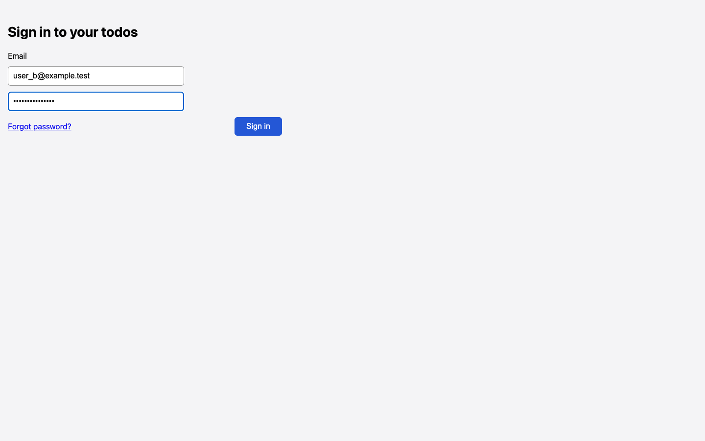

# Password field on sign-in has no label or accessible name

## Steps

1. Open /login
2. Read the snapshot

## Expected

Password input has a visible label and accessible name.

## Actual

Only Email has a label. The second textbox is unnamed, and it is a plain textbox in the snapshot.

## Evidence

## Suggested next step

None given.
