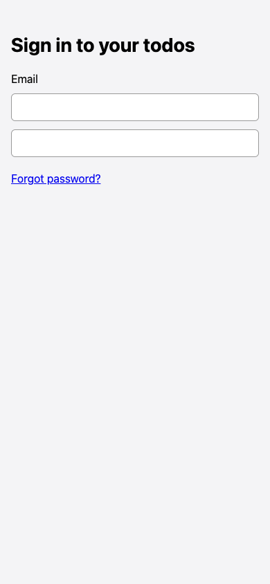
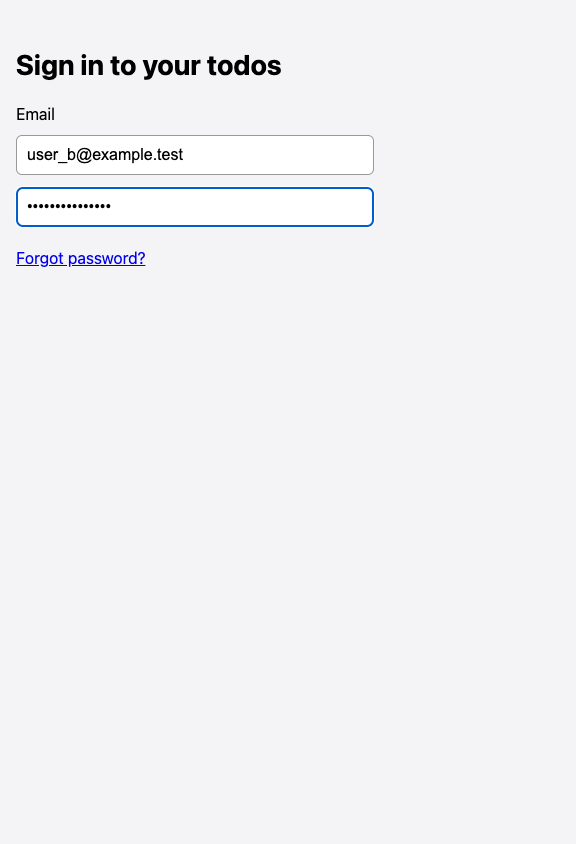

# Sign in button not visible at 390px width

## Steps

1. Open /login at 390x844
2. Look for the Sign in button

## Expected

Sign in button is visible and tappable.

## Actual

The button is in the accessibility tree but nothing is drawn where it should be (it is visible at 1440px). Only the fields and Forgot password link show.

## Evidence

## Suggested next step

None given.
