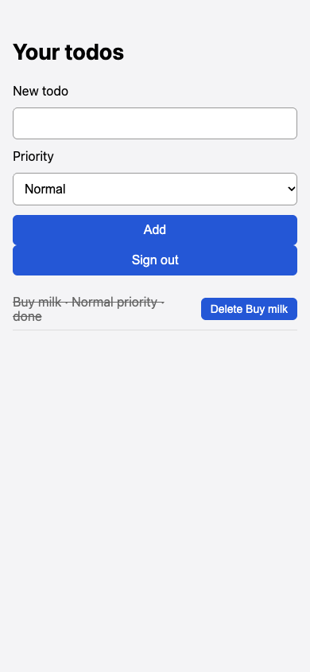

# Todo saved with Normal priority after choosing Low

## Steps

1. Sign in
2. Type 'Buy milk'
3. Choose Low in Priority
4. Click Add

## Expected

The todo shows 'Low priority'.

## Actual

The item reads 'Buy milk · Normal priority'. Same as at 1440px with High.

## Evidence

## Suggested next step

None given.
